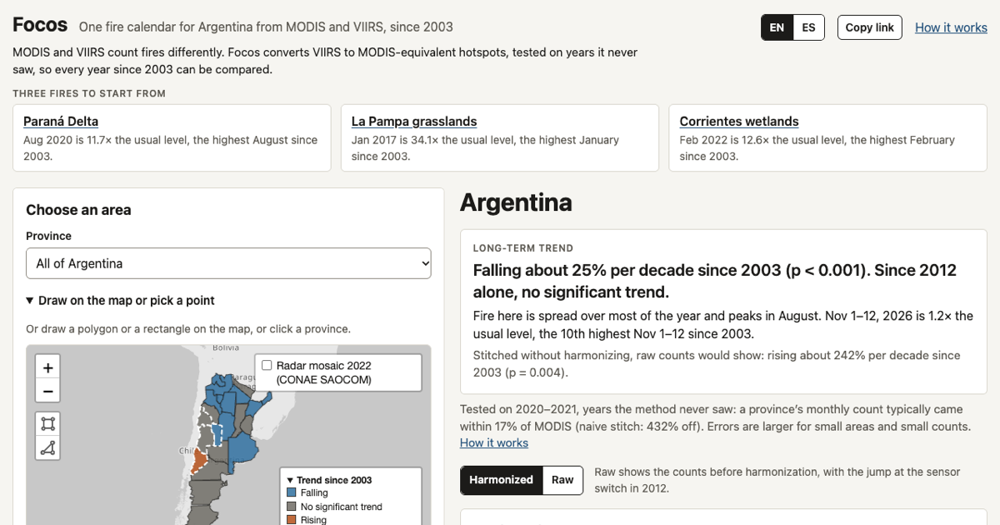

# Focos

One fire calendar from three satellites.

Focos merges NASA FIRMS active-fire hotspots from MODIS (Aqua) and VIIRS (S-NPP, then NOAA-20) into a single MODIS-equivalent record for Argentina, from 2003 to the present. Pick a province, draw an area or enter a point, and see when it burns, which years were worst, and whether this month is abnormal. It is meant for anyone who has to read Argentina's fire history across the 2012 change of satellite: provincial fire services, researchers, journalists and students.

**Try it: [ardbiu.github.io/FOCOS](https://ardbiu.github.io/FOCOS/)** (English and Spanish; the method and every test number are on its "How it works" page).

The problem in one line: joined as they are, the two sensors make Argentina's fire count jump from about 46,000 in 2011 to 167,000 in 2012, a rise no fire caused. Focos removes that jump and tests the result on years it never saw.



Three places to start:

- [The Paraná Delta fires of August 2020](https://ardbiu.github.io/FOCOS/#area=prov:30&sel=2020-08): the highest August since 2003, in a held-out test year, with the month's satellite detections on the map.
- [The same calendar before harmonization](https://ardbiu.github.io/FOCOS/#view=raw): the Raw switch shows the jump that the change of sensor puts into the record in 2012.
- [How it works](https://ardbiu.github.io/FOCOS/method.html): the method and the held-out test, every number read from `validation.json`. The team's one-page method brief, with the questions a judge may ask, is in [`docs/method-brief.md`](docs/method-brief.md).

Built for the NASA Space Apps Challenge 2026, "Harmonization of MODIS and VIIRS Hot Spots". "Focos de calor" is the term Argentina's fire agencies use for satellite hotspots.

## The problem

MODIS has watched fires since the early 2000s and is at the end of its life. VIIRS replaces it, but VIIRS sees much smaller fires, so the two records cannot be read as one. Stitch them together as they are and Argentina's fire count appears to jump from 45,740 in 2011 (Aqua MODIS pixels) to 167,274 in 2012 (Aqua for January, raw VIIRS pixels from February). Nothing happened on the ground; the sensor changed.

Why not simply stay on Aqua? Its orbit is drifting and it will stop. The bridge to VIIRS has to be built and tested while both still fly, so that the record can rest on it afterwards.

The handovers keep coming. S-NPP, the first VIIRS satellite, stopped delivering data at 13:00 UTC on 2 November 2026 ([NASA Earthdata notice for FIRMS users](https://www.earthdata.nasa.gov/news/blog/transitioning-from-s-npp-viirs-omps-what-nasa-firms-users-need-know)), and NOAA-20 now carries on.

## Method

Aqua, not Terra, is the MODIS reference: Aqua and S-NPP both cross in the early afternoon, and fire has a strong daily cycle, so a morning satellite such as Terra sees a different set of fires.

1. **One counting unit for every sensor.** A fire cell-pass is one 0.01° cell, on one local date, by day or by night, seen by one sensor. Several pixels in the same cell-pass count once.
2. **Convert VIIRS down to MODIS, never MODIS up.** Nobody can recreate small fires MODIS never recorded. For each 5° block, season and day/night, a ratio says how many Aqua cell-passes one VIIRS cell-pass is worth. Block ratios are pulled toward the national ratio where data is thin.
3. **Every hotspot carries a weight.** Aqua carries the record through January 2012, S-NPP from February 2012 through October 2026, and NOAA-20 from November 2026. On 62 days between January 2019 and August 2026 when S-NPP delivered no data, or none by day, NOAA-20 (flying since April 2018) carries the day instead. Every number in the app is a sum of these weights, so the calendar, the map and the downloads tell the same story: for a province the weights of its detections add up to its calendar count, within a few hotspots at the borders, and a drawn area's calendar is summed on the 5 km grid.

Cleaning keeps presumed vegetation fires (`type` 0), confident detections (MODIS confidence 30 or more; VIIRS nominal or high) and one copy of exact duplicates. Dates are local solar dates.

### Choosing the calibration

Three candidates were scored by leave-one-year-out inside 2012–2019. The score is the median absolute error of province-month totals, using province-months with at least 20 Aqua cell-passes. The rule was fixed beforehand: take the simplest candidate within 10% of the best score.

| Candidate | What it is | Score |
|---|---|---:|
| Naive | Raw VIIRS pixel count, no conversion | 405.5% |
| C1 | One national ratio per season and day/night | 20.8% |
| **C2** | A ratio per 5° block, season and day/night, shrunk toward C1 (m = 200) | **17.2%** |
| C3 | Strength-aware weights with a per-block adjustment (m = 50) | 17.7% |

C1 is not within 10% of the best, so the rule picks C2. The model was frozen in `pipeline/data/calibration.json` before any test-year result was computed.

## Results on years the method never saw

The test years are 2020 and 2021. Harmonized S-NPP is compared with Aqua MODIS on days both sensors worked.

| Scale | Pairs | Bias | Median absolute error | Log correlation |
|---|---:|---:|---:|---:|
| National, monthly | 24 | −0.1% | 8.3% | 0.993 |
| Province, monthly | 331 | −0.9% | 17.0% | 0.972 |
| 1° tile, monthly | 921 | −4.6% | 22.6% | 0.913 |

The same test for the naive stitch, raw VIIRS pixels against raw Aqua pixels: national bias +428%, province-month error 432%.

All three targets set in advance were met: national bias within ±10%, province-month error at most 25%, national log correlation at least 0.95.

**How to read these numbers**

- The comparison leaves out 191 days: days on which a sensor delivered no data, and a window from 16 August to 2 September 2020 set aside before the test as a suspected Aqua outage. The archive has Aqua data on most of those days, so this is a precaution. The window falls inside the Paraná Delta month (August 2020); the full-month comparison for Entre Ríos below counts every day.
- They hold where there is enough fire to measure: months with at least 20 Aqua cell-passes. With less fire the error grows: 43% for province-months with 5 to 19, and over 100% below 5.
- The national bias is small partly because two years offset each other: the record ran 2.7% under Aqua in 2020 and 5.0% over in 2021.
- Some provinces run persistently high or low. Over 2020–2021 nine provinces were off by more than 15%: Neuquén +68%, Mendoza +37%, San Juan +26%, Santa Fe +25%, Jujuy +18%, Buenos Aires +17%, Catamarca −17%, Córdoba −21%, San Luis −27%. In Neuquén the excess sits in cells where VIIRS detects on many days a year, most likely fixed heat sources that the archive labels as fire. The app flags these provinces. The method was not re-tuned after seeing this; that would be fitting to the test years.
- Extreme months are understated. On the test years, months at 5 to 10 times Aqua's usual level ran 9% low and months at 10 times or more ran 11% low, while months under half the usual level ran 25% high. The worst case found is outside the test years: for Corrientes in February 2022 the record says 1,970 where Aqua itself recorded 3,361, which is 41% low. Such a month is still flagged as the highest of its calendar month; its size is understated. The two other story months are close: Entre Ríos in August 2020 is 2,188 against Aqua's 2,174, and La Pampa in January 2017, a month inside the training years, is 2,281 against 2,083.
- The busiest month of the year matches Aqua's in 86% of province-years (naive: 77%; 44 province-years).
- At the first seam (February 2012 to December 2013, inside the training years) the national series differs from Aqua by −0.2%, with a monthly error of 4.4%.
- 2020 and 2003 are level within this error (70,369 and 70,344). Raw counts would say 2020 had 5.5 times the fire of 2003.
- The yearly ratio of Aqua to harmonized S-NPP stays between 0.95 and 1.04 from 2012 to 2022, then rises to 1.06 in 2023, 1.16 in 2024 and 1.09 in 2025. A later Aqua overpass, as its orbit drifts, would do that; S-NPP's outages in 2024 and a change of MODIS collection in 2023 (the archive's version field moves from 6.03 to 61.03) may add to it. In 2026, up to S-NPP's last day, the ratio is 0.92: 2026 had little fire, and the record reads high in quiet months. This project does not prove the cause.

### What the trends look like, raw and harmonized

The app computes a trend for every area: a Theil–Sen slope of the yearly totals over the complete years 2003–2025, with a Mann–Kendall test at p < 0.05. The same calculation on the raw counts shows what a naive stitch would have told a reader.

- **Nation:** raw counts rise about 242% per decade (p = 0.004); the harmonized record falls about 25% per decade (p < 0.001).
- **Provinces:** raw counts rise in 22 of 24. The harmonized record rises in 1 (Neuquén), falls in 11, shows no significant trend in 10, and has too little fire to assess in 2 (Ciudad Autónoma de Buenos Aires, Tierra del Fuego).

Almost every "rising" raw trend is the change of sensor in 2012, not fire.

**A check that does not lean on the method.** Aqua MODIS never changed sensor. Its own national totals fall about 22% per decade over 2003–2025 (p = 0.002), close to the harmonized record's 25%. Aqua's orbit has drifted to a later overpass, nearer the afternoon peak of fire, so its last years may read high (see the yearly ratio above) and this check, if anything, understates the fall; it supports the national trend without proving it. Over 2012–2025 alone neither Aqua nor the harmonized record shows a significant trend: most of the fall came before 2012. The method page computes both from `validation.json`.

**A robustness check on the nine provinces that ran more than 15% from Aqua in the test.** Each one's trend is computed again with its test-year gap taken out of every VIIRS year (the VIIRS months divided by 1 + bias). This is a check, not a correction: no count in the app changes.

- The trend holds in five: Buenos Aires, Catamarca, Córdoba and Jujuy (still falling) and Santa Fe (still no significant trend).
- It changes in four. Neuquén's rise, the only rising province, and San Luis's fall both become no significant trend. Mendoza and San Juan go from no significant trend to falling (about 18% and 20% per decade).

The app says this under the caution line of each of these provinces, does not lead with a trend that fails the check, and dashes the outline of these four provinces on the trend map.

### NOAA-20, the second handover

No new method was chosen for NOAA-20. The recipe frozen for S-NPP was re-fitted against Aqua on April 2018 to December 2019, the stable period both flew, and tested on the same held-out years.

| Check | Bias | Median absolute error | Log correlation |
|---|---:|---:|---:|
| Against Aqua, 2020–2021, national monthly (24) | −1.9% | 7.1% | 0.995 |
| Against Aqua, 2020–2021, province monthly (331) | −2.6% | 17.5% | 0.972 |
| Against Aqua, 2020–2021, 1° tile monthly (924) | −5.4% | 23.8% | 0.904 |
| Against harmonized S-NPP, 2022–2025, national monthly (48) | −2.2% | 3.9% | 0.997 |
| Against harmonized S-NPP, 2022–2025, province monthly (667) | −2.3% | 10.3% | 0.987 |

The first NOAA-20 fit was wrong, and the held-out test is what caught it: national bias +15.5%. NOAA-20's record starts on 1 April 2018, and the training table had counted Aqua's fire from January to March 2018 with nothing on the NOAA-20 side. The pipeline now compares two sensors only from the day the newer one starts, and the numbers above are from the refit.

## Data

- NASA FIRMS MODIS active fire detections, yearly country files for Argentina, 2002–2025.
- NASA FIRMS VIIRS S-NPP 375 m active fire detections, yearly country files for Argentina, 2012–2025.
- NASA FIRMS VIIRS NOAA-20 375 m active fire detections, yearly country files for Argentina, 2018–2025.
- For 2026, the same three products from the FIRMS API: the standard product to 31 July (MODIS to 31 August), near real time after that.
- Province boundaries: Georef, Argentine government (CC BY 4.0).
- Optional map layer in the app: SAOCOM L-band radar mosaics of each province, 2022, from CONAE (Argentina's space agency), loaded from CONAE's open map service only when the reader turns it on. It gives land context and never feeds a number.

46 files, about 510 MB, downloaded 2026-11-12. After cleaning: about 1.0 million Aqua pixels, 2.55 million S-NPP pixels and 1.5 million NOAA-20 pixels.

The 2026 months come from the FIRMS API with a free MAP_KEY: 190 requests of five days each, pulled on 2026-11-13, with no gap between the standard and the near-real-time product. The record runs to 2026-11-12. S-NPP carries it to 31 October 2026 and NOAA-20 from 1 November 2026: S-NPP's last data came on 2 November, and the record changes satellite at the start of that month. The last, unfinished month is compared with the same days of that month in other years. Near-real-time rows have no `type`, so rows in cells where the archive shows mostly fixed heat sources are dropped; applied to 2021–2025 archive rows, that rule changes the national count by +0.3%.

An outage day is a day when a sensor reports nothing, or nothing by day, although another satellite saw enough fire that at least 10 detections were expected. A quiet day is not an outage. Months in which the sensor carrying the record lost more than 10% of its days are marked incomplete. A day that NOAA-20 filled is not lost, so no month is marked today.

## Run it

```bash
cd pipeline
uv venv --python 3.11 .venv && uv pip install --python .venv/bin/python -r requirements.txt
.venv/bin/python -m pytest tests -q              # 160 tests
.venv/bin/python -m focos_pipeline.run download  # 46 FIRMS files, about 510 MB
.venv/bin/python -m focos_pipeline.run all       # build, weigh, validate, export, check
```

`freeze` and `freeze-noaa20` choose and freeze the calibrations. They refuse to run twice; the frozen models are already in the repo.

For 2026, put `FIRMS_MAP_KEY=...` in a `.env` file at the repo root (it is git-ignored), then run `download-2026` and `all`.

The web app lives in `web/` (`npm install`, `npm test` for its unit and page tests, `npm run dev`, `npm run build`). It reads the files in `web/public/data`, which the pipeline writes.

### Another country

Country-specific values sit in one block, `REGION`, in `pipeline/focos_pipeline/config.py`: the FIRMS country name, the bounding box, the grid and the province file. Change them, download, freeze a calibration for that country and export. A new country also needs its own held-out test before its numbers can be trusted: the calibration and the test in this repository are Argentina's.

## Limits

- Satellites miss fires under cloud or thick smoke, and small or short fires between passes.
- "MODIS-equivalent" undercounts small fires by design. The raw VIIRS points are still in the downloads.
- Hotspot counts are not burned area.
- Custom areas are resolved at about 5 km.
- Harmonized values carry an error that depends on how much fire there is and on the province (see above).
- Fixed heat sources that the archive labels as fire inflate the VIIRS era in a few places, Neuquén most of all.
- Very large fire events are understated: one ratio per block and season cannot follow a month in which most fires are big enough for MODIS to see.
- Before April 2018 there is no second VIIRS satellite. S-NPP lost six days between 2012 and 2017, and those days are simply missing; a month that lost 10% of its days or fewer is not marked.
- Days filled from NOAA-20 carry NOAA-20's error, which is close to S-NPP's (see its table).
- Province by province the two VIIRS satellites are not identical. In 6 of 21 provinces NOAA-20's gap to Aqua in the test years differs from S-NPP's by more than 10 points (most in Entre Ríos: S-NPP +3%, NOAA-20 −13%), so there the months NOAA-20 carries, from November 2026 and on the days it fills, can sit above or below the S-NPP months.
- Near-real-time data is revised later.
- Focos shows history and how unusual the present is. It does not forecast.

## Audit trail: what changed after the first results

These changes came after the first run of the held-out test. None of them touched the frozen calibration.

**What changed after a second review.** The first run of this test gave a province-month error of 17.3% and a national bias of −0.5%, with 119 days excluded. A second review, by a separate Claude session that had not written the code, then found that the outage rule missed days when a sensor lost only its daytime pass. The rule was tightened and NOAA-20 became an extra reference for spotting outages, so 167 days were then excluded and the numbers above are the recomputed ones. The frozen model did not change. Adding the 2026 data on 2026-11-13 brought the count to 191; all 24 new days are in 2026 and no test number moved.

**What changed after the 2026 data came in (2026-11-13).** April 2026 showed as the lowest April on record only because S-NPP had lost three days of it. NOAA-20, already calibrated and tested, now carries every day on which S-NPP was out and NOAA-20 was working: 62 days from January 2019 to August 2026. This changes the series, not the calibration or the test, which compares S-NPP alone with Aqua on days both worked. In the 18 months that contain a filled day, the record went from 13.9% below Aqua's own count to 3.2% below. July and August 2022, July 2024, July 2025 and July 2026 had been marked incomplete and are now whole, so 2022, 2024 and 2025 count toward the national trend, which reads 25% per decade where it read 28%. The second review also ran the test with no days excluded at all and got 17.05% (a run of its own, not stored in `validation.json`), so the exclusions do not flatter the result.

## How SI was used

The 2026 Space Apps rules call AI tools "Super Intelligence (SI)" and ask teams to say how they were used.

- Claude (Anthropic), an AI coding assistant, was used for assisting in writing the pipeline code, the web code and their tests
- The app itself uses no SI at runtime.
- No SI-generated images are used.

## License

Apache-2.0. See `LICENSE` and `NOTICE`.

We acknowledge the use of data from NASA's Fire Information for Resource Management System (FIRMS), part of NASA's Earth Science Data and Information System (ESDIS).
